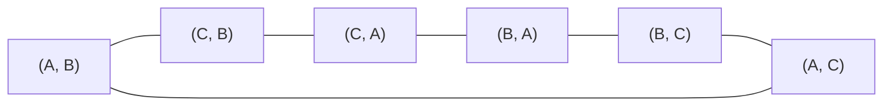

# The six pillars of the carrier-pair protocol

The system is a candidate two-wall carrier-pair routing and maintenance subsystem.
Its class-level state is `(b, c)`: two distinct, nonzero elements of the D₄ glue
group. The omitted label is `b + c`; orientation records which class is on which
wall. Its six states come from three labels and two orientations. The six pillars
describe how the whole subsystem persists.

This is a finite quotient of the carrier system. Selecting it as a physical protocol,
placing its registers on the native substrate and deriving its event clock remain
obligations. No particle identity or measured value is used to choose this construction.

| Pillar | Checked part | Remaining physical obligation |
|---|---|---|
| **Capacity** | Six class-pair labels (`GenerationSector.gen_count`); task-facing MAP lower bounds of three or six code values. | Allocate the native modes, redundancy and record supply; the quotient count is not the full carrier-state count. |
| **Map** | Exact retained label/orientation code, coherent isometry and move-query correctness (`GenerationMapObligations`). | Derive which future queries the actual maintenance task must answer. Retention does not imply measurement of the reference class. |
| **Protocol** | Guarded class moves and every fixed schedule are reversible (`GenerationPairProtocol.run_bijective`). The finite-label machine instantiates the framework's `PMRequirements`. | Select and implement the microscopic moves and schedule; the abstract macrostep is not a calibrated substrate tick. |
| **Governor** | Under the specified accept-or-idle policy, a move executes exactly when the pair remains valid. The resulting governor is unique and reversible. | Derive the actual restrictions. Pair validity alone does not protect the omitted label. |
| **Toll** | A supplied baseline and supplied move prices accumulate along the full history. An active round trip costs twice its per-step charge despite returning to its initial state. | Derive native primitive tariffs and durations. Class-level zero displacement can hide native carrier/root work. |
| **Margin** | An available, retained event tag permits exact coherent correction of a tagged wall fault. No record-free repair on the full six-state logical space corrects every unknown wall fault. | Derive fault detection/tag acquisition, physical redundancy, clean supply, noise strength and repair timing. |

## The protocol inside its host

The [reference-maintenance host map](HOST-MAINTENANCE.md) identifies the existing
native implementation, all six pillars, and the distinction between writing and
exporting a record.

The candidate protocol runs on the larger carrier/substrate system. Its six-pillar
accounting must include what crosses that boundary: allocated modes and record
space (Capacity), retained distinctions (Map), admitted joint moves (Protocol),
shared restrictions (Governor), primitive work and clock use (Toll), and fault and
fresh-record supply (Margin). The current quotient does not identify a unique
persistent host or prove that its resources are available. Those allocations need
their own maintenance accounting; an unused inner mode need not be unused by the host.

`ReferenceNodeBoundary` makes one such interface precise in the existing static
conserving-network model. Free internal spectator ports eliminate to the two-leg
series response even if their links exist. More generally, `closed_host_response`
allows any finite host with symmetric internal links, attached only to that node,
in steady local balance with no other injections. Its internal currents cancel,
so it draws no net steady current. A host-anchored port instead adds a load.
The `α/3` entry of a retained three-port star and the `α/2` response of a two-port
with its spectator floating therefore describe different boundary conditions.
Conservation of the whole host-plus-protocol network permits current across their
boundary; only a closed two-port contract excludes that load. Open record flow and transient storage are not covered by the closed-host result.
Selecting the native host boundary remains an open premise, not an inference from particle occupancy.

## What the governor does and does not protect

Each edge below is a valid, reversible single-wall class shift. `A`, `B`, `C`
are the three nonzero glue classes; they are not particle or colour assignments.

`routes_cover` gives paths between every pair of states. Consequently a diagonal
state label invariant under *every* guarded wall move must be constant
(`wall_invariants_constant`). This does not rule out quantum invariant subspaces;
it identifies the failure of this validity guard to protect a nontrivial classical
pair label. Stronger restrictions or restoration are needed if that label is the
identity the protocol must keep.

Matched class translations preserve the omitted label and can exchange its two
orientations. The same orientation exchange needs exactly three moves in the
single-wall family (`swap_three`, `swap_needs_three`). These are quotient-move counts,
not a native-root price ratio or an event-clock calibration.

## MAP and Margin together

A stored event tag can control the inverse wall move, restoring arbitrary coherent
amplitudes (`coherent_fault_echo`). The event tag remains stored; the construction
does not reset it or provide a fresh supply. It is a supplied operational log
alphabet, not an identification with a native register of matching size.

Thus a reference-class measuring circuit is one candidate maintenance mechanism,
not a consequence of the six pillars alone. The reference's class definiteness,
the restoring-node host boundary, physical register factorization and crossing/flip clock
calibration remain in [REVIEW-AND-NEXT.md](REVIEW-AND-NEXT.md).

## Sources

- [GenerationMapObligations.lean](GenerationMapObligations.lean): task-facing information and coherent coding.
- [GenerationPairProtocol.lean](GenerationPairProtocol.lean): guarded updates, PM requirements, transition paths, toll and tagged-fault correction.
- [ReferenceNodeBoundary.lean](ReferenceNodeBoundary.lean): floating spectator elimination and host-load boundary.
- [GenerationSector.lean](GenerationSector.lean): the glue-class move rules used by both.
